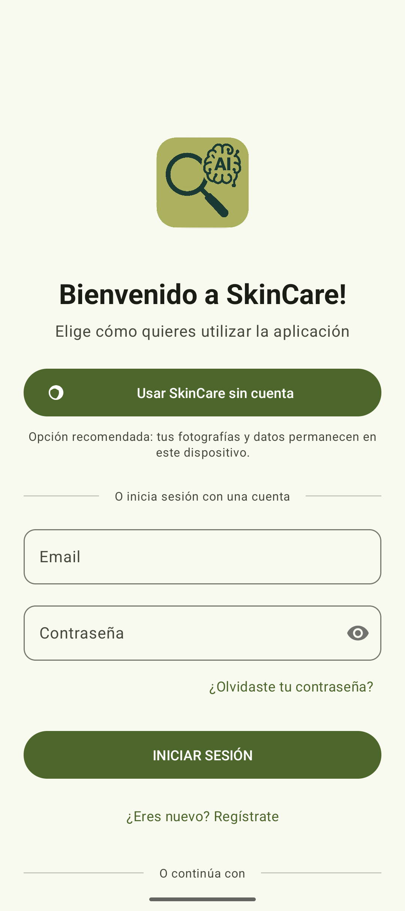
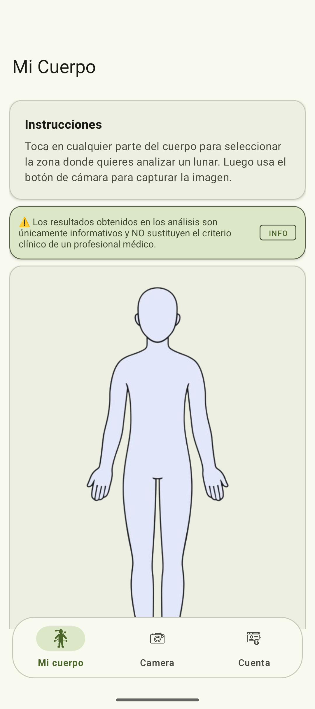
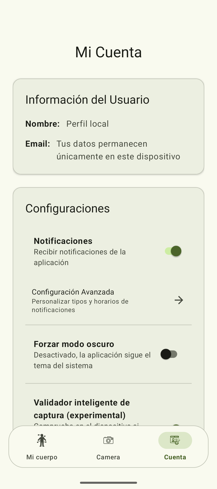

<div align="center">
  
  <h1>SkinCare</h1>
  <p>Aplicación Android de captura guiada y registro fotográfico de lunares</p>
</div>

Proyecto educativo en desarrollo que combina cámara, procesamiento de imágenes
e inferencia local. Incluye mapa corporal, perfil sin cuenta, historial en el
dispositivo, recordatorios y copias manuales cifradas.

> Las funciones de análisis son experimentales. La aplicación no está validada
> para diagnóstico ni para descartar melanoma y no sustituye una evaluación profesional.

## Capturas

<table>
  <tr><th>Acceso</th><th>Mapa corporal</th><th>Perfil local</th></tr>
  <tr>
    <td></td>
    <td></td>
    <td></td>
  </tr>
</table>

Capturas reales obtenidas en un emulador con perfil vacío, sin datos personales
ni fotografías de lesiones.

## Tecnologías

Kotlin · CameraX · OpenCV · LiteRT · Room · Hilt · Material Components · Firebase Authentication

## Compilar

Se necesita Android Studio compatible con AGP 8.6, JDK 17 o compatible con Gradle
8.7, Android SDK Platform 34 y Build Tools 34.0.0. El wrapper de Gradle está incluido.

```bash
git clone https://github.com/sogekingdabest/SkinCareApp.git
cd SkinCareApp
```

Para comprobar una build sin credenciales, copiar
`app/google-services.json.example` a `app/google-services.json` en un clon nuevo.
El ejemplo contiene valores ficticios; para probar autenticación se necesita
la configuración de un proyecto Firebase propio, que no se versiona.

Windows:

```powershell
.\scripts\verify-android.ps1 -IncludeRelease
```

Linux/macOS:

```bash
./gradlew --no-daemon :app:assembleDebug :app:testDebugUnitTest :app:lintDebug
```

## Licencia

Código bajo [GPL-3.0](LICENSE). Los modelos y datasets pueden tener condiciones adicionales.
